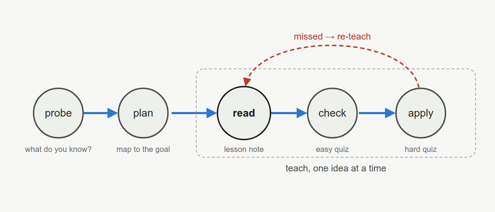

# learn-claude

A tutor that runs inside [Claude Code](https://code.claude.com) and writes its lessons into your Obsidian vault.

Point it at a topic or a textbook. It teaches one idea at a time, checks that you have understood each one before it moves on, and leaves behind notes that read like a textbook chapter. It runs on a normal Claude subscription, so you don't need an API key.

learn-claude is a Claude Code port of Eero Alvar's [learn](https://github.com/amosblomqvist/learn), which was built for the [pi](https://github.com/earendil-works/pi) coding agent and is shown in the video [How I Use AI to Learn Things](https://www.youtube.com/watch?v=kzcI5F4tGiU). The core of it is Eero's: the teaching method, the graded quiz popup, the lesson written into a markdown note, and the subagents that check facts and draw diagrams. This version reworks those pieces for Claude Code and adds textbook courses, typed answers, exams, mock interviews, technique notes and the practice modes.



## What a lesson is like

You ask to learn something, say `teach me how TCP achieves reliability`. The teacher first asks a few quick questions to find where your knowledge runs out. Then it proposes a plan: a small map that starts from things you already know and ends at the thing you want. Once you agree to the plan, it teaches one idea at a time.

Each idea gets a short section in your note, ending with a one- or two-sentence key idea. When you have read it, you type `ready`, and two quizzes pop up over the terminal. The first checks that you read carefully. The second, the apply question, is where the method shows. It is not just the worked example again. It changes one thing about it, so that the recipe from the section no longer works on its own, and only knowing *why* the recipe works gets you the answer.

Here is part of the first lesson of a course on Kevin Murphy's *Probabilistic Machine Learning: An Introduction*. The section argues that a classifier should output a probability, not just a label, and makes the case with a spam filter. Here is its example, shortened:

> Deleting a real email costs 10 (you miss something important), and letting a spam through costs 1. The filter says an email is spam with probability $p$. Deleting has an expected cost of $10(1-p)$ and keeping has an expected cost of $p$, so you delete only when $p > 10/11 \approx 0.91$. At $p = 0.7$ the filter's best guess is "spam", yet the right action is to keep the email.

A filter that gave only the label would delete that email. In the section's words: uncertainty is information, and throwing it away gives worse decisions.

The apply question moves the idea to a clinic. A model gives the probability $p$ that a patient has a disease. Treating a healthy patient costs 2, not treating a sick patient costs 18, and correct decisions cost 0. What is the threshold, and should you treat at $p = 0.15$?

Putting the big cost on top again, as in the spam case, gives 18/20 = 0.9, which is wrong. In the spam case the expensive mistake was acting (deleting a real email), so the threshold was high. Here the expensive mistake is *not* acting, so the threshold is low. Treating costs $2(1-p)$ in expectation and not treating costs $18p$, so treat when $2(1-p) < 18p$, that is, when $p > 0.10$. At $p = 0.15$ you treat, even though the patient is most likely healthy. The quiz's other options are what a half-learned recipe produces: 0.9 attaches each cost to the wrong mistake, 0.5 ignores the costs, and 0.11 divides one cost by the other instead of by their sum.

If you pick one of those, the teacher does not move on. It re-teaches the part you missed and sets a fresh question before it builds anything on the idea.

In Obsidian the note reads like a textbook chapter. Maths is rendered, diagrams are embedded, and each quiz folds into a single line (✓ or ✗ and the question) that you can click open to see your answer and the explanation.

## What else it does

- **Follow a textbook.** Give it a PDF and pick the chapters. Lessons follow the book's sections, equation numbers and figures, so the book and your notes line up. Stuck on an exercise? It helps one step at a time, and shows a full solution only when you allow it.
- **Stop and come back.** `/lesson pause` saves where you are. Next time, the teacher offers a short recall check before carrying on.
- **Sit an exam.** `/exam` writes a paper on a chapter. You answer it in Obsidian, hand it in, and get it back marked, with feedback under each answer.
- **Do a mock interview.** `/interview` is a timed round of new problems, with a clock in the tmux status bar and an interviewer who stays quiet while you make progress and nudges you when you are stuck.
- **Collect techniques.** Each problem-solving trick (symmetry, linearity of expectation, the pigeonhole principle…) gets its own note. The note lists every problem that used the trick, and, in your words, what in a problem should make you think of it.
- **Review what you missed.** Every question you get wrong comes back later as a new question on the same idea, spaced out over weeks (`/review`). `/drill` mixes problems from all your techniques without saying which one each needs.
- **Practise mental arithmetic.** `/arith` is a timed sprint in the style of [Zetamac](https://arithmetic.zetamac.com).
- **Practise coding.** `/code` sets LeetCode-style problems that you solve in your own editor. Hidden tests judge them, and a passing solution gets reviewed the way an interviewer would.

When the teacher is unsure of a fact, a research subagent checks it on the web. Diagrams are drawn by another subagent, which looks at the rendered picture before you see it.

## Getting started

You need Claude Code 2.1 or later, Python 3.10+, and tmux 3.2+ for the quiz popup. Obsidian is where the notes look best, but any markdown viewer works. Textbook courses need poppler (`pdftotext` and friends) and `mutool`, and diagrams need Node; without them you lose only those features. The [guide](docs/guide.md#installing-and-updating) has the full list.

The repository is itself a `.claude` folder, so clone it into the folder you want to learn in. The root of your Obsidian vault is the best place, because notes and diagrams then render where they are written.

```bash
cd ~/path/to/vault
git clone https://github.com/LnBn/learn-claude .claude
bash .claude/scripts/install.sh   # diagram renderer, quiz server, Obsidian styles
```

If the folder already has a `.claude` of its own, move it aside first: `git clone` won't write into a folder that isn't empty.

Start Claude Code from that folder, inside tmux, and accept the prompt to enable the `quiz` server (it runs the popup):

```bash
tmux
claude
```

Then tell it where to write the note, and what you want to learn:

```
/md-log lessons/tcp.md
teach me how TCP achieves reliability
```

Open `lessons/tcp.md` in Obsidian and read along there. You can type a question at any point, and the answer goes into the note next to the part it is about.

To update later, run `git -C .claude pull` and start a new session.

## Commands you'll use most

```
/md-log notes/topic.md        # write this session into a note
/lesson pause                 # save a checkpoint
/lesson resume notes/topic.md # carry on another day

/course new ~/books/book.pdf  # turn a textbook into a course
/course next                  # study the next section (also resumes)
/exercise 2.3                 # help with exercise 2.3

/exam                         # a paper on the chapter you just finished
/interview                    # a timed mock interview
/review   /drill   /arith     # practice
```

Every command, key and file is in the [user guide](docs/guide.md).

## How it works

The teacher is the Claude Code session itself, guided by a set of [skills](https://code.claude.com/docs/en/skills): one holds the teaching method, the others hold the procedures for courses, exams, interviews and practice. Quizzes go through a small [MCP](https://modelcontextprotocol.io) server that opens the popup and marks your answer. [Hooks](https://code.claude.com/docs/en/hooks) copy the conversation into your note as you go. The parts that have to be exact, such as marking typed answers, scheduling reviews and grading exams, are plain Python scripts with unit tests. [docs/architecture.md](docs/architecture.md) explains how it fits together, and which parts are fragile.

## Before you rely on it

- The teaching method was written for one learner. Edit `skills/teach/SKILL.md` to fit how you learn.
- The note mirror reads Claude Code's session transcript, whose format is internal and can change between releases. If the teacher's text stops appearing in your notes, the [guide](docs/guide.md#troubleshooting) shows how to rebuild a note.
- Everything runs on your machine except the model calls and the researcher's web searches. The model calls use your Claude Code login and count towards your plan's usage. The researcher and diagram subagents run on Sonnet by default, which uses less of your plan.
- It is developed on Linux. It should work anywhere tmux runs, which on Windows means WSL, but that is untested.

## Credits

The teaching method, the quiz popup, the note mirror, the skills and the agent prompts come from [Eero Alvar's learn](https://github.com/amosblomqvist/learn). The port to Claude Code, the changes to those pieces, and the courses, exams, interviews, technique notes and practice modes are by Lachlan Burton, written with Claude.

If something breaks or you have an idea, please open an issue.
